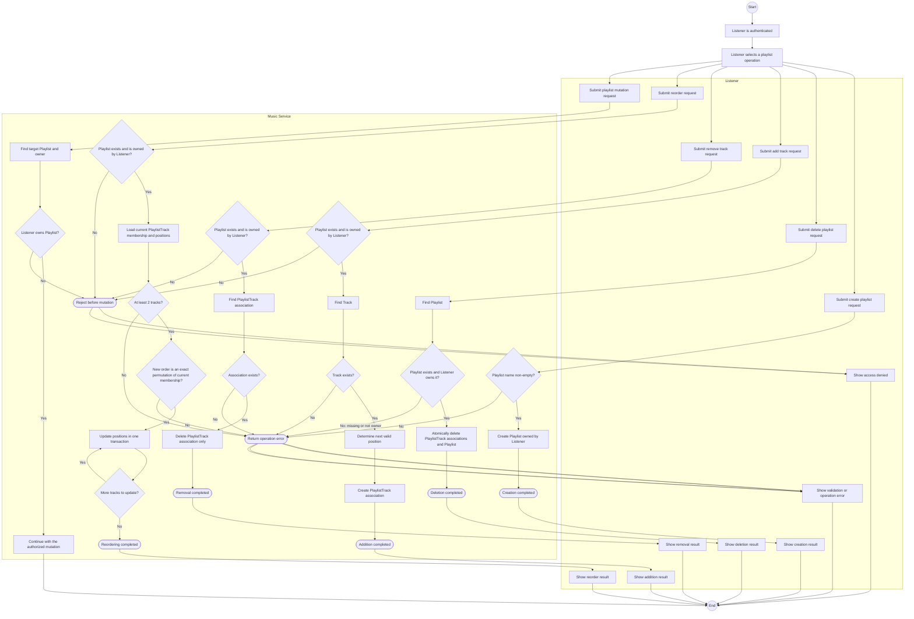

# BP-01 — Playlist Management Activity Diagram

This diagram models the process-level behavior of playlist management. It uses a Mermaid flowchart with responsibility lanes to represent a UML Activity Diagram. The Listener initiates an operation; the Music Service performs validation, authorization, and persistence.

## Diagram notes

1. **Atomicity:** deletion and reordering are treated as atomic persistence operations. If persistence fails, the operation must not leave a partial result.
2. **Authorization:** every mutation branch checks ownership before changing data. The generic “other mutation” branch makes the denial Use Case explicit; the concrete add, remove, reorder, and delete branches also contain their own ownership gate.
3. **Track preservation:** removing a track from a playlist deletes only the `PlaylistTrack` association. It does not delete the `Track`.
4. **Reorder loop:** the loop updates each track's position sequentially within one transaction. There are no parallel branches or fork/join nodes.
5. **Error paths:** missing playlists, invalid input, missing tracks/associations, invalid order, insufficient track count, and persistence failures terminate through an error result. Authorization failures terminate through an access-denied result.
6. **No-response behavior:** the diagram models logical process outcomes, not transport timeouts. A client must not report success without a service result. An uncertain timeout after a write requires state reconciliation.
