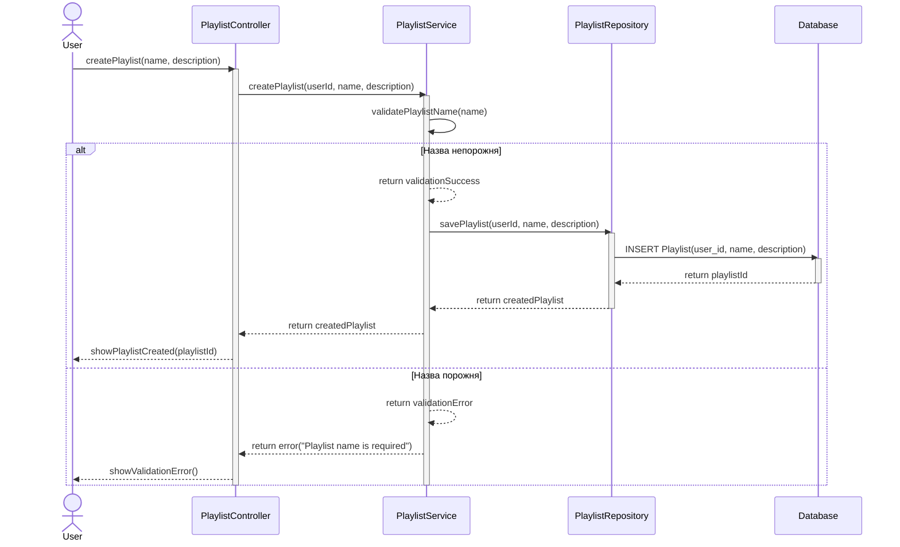
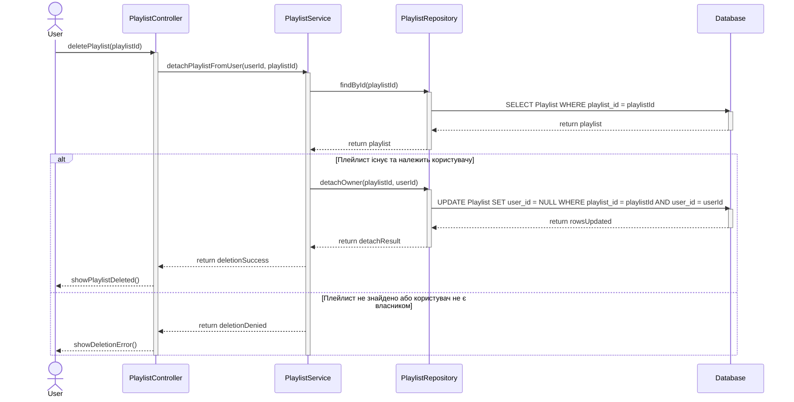
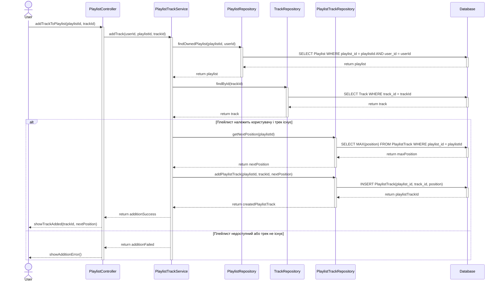
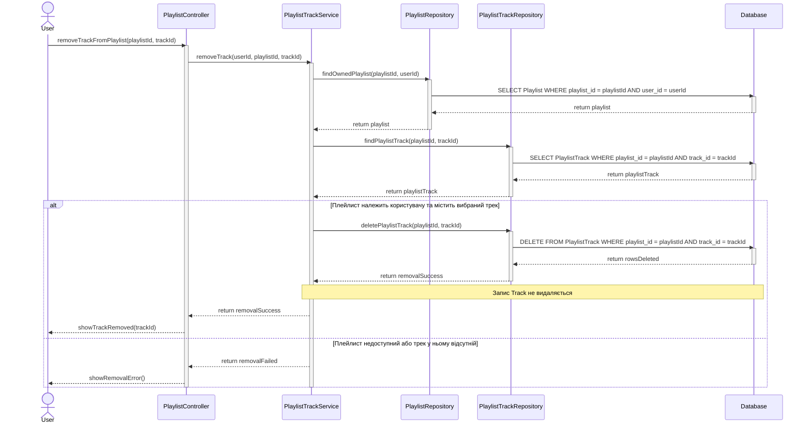
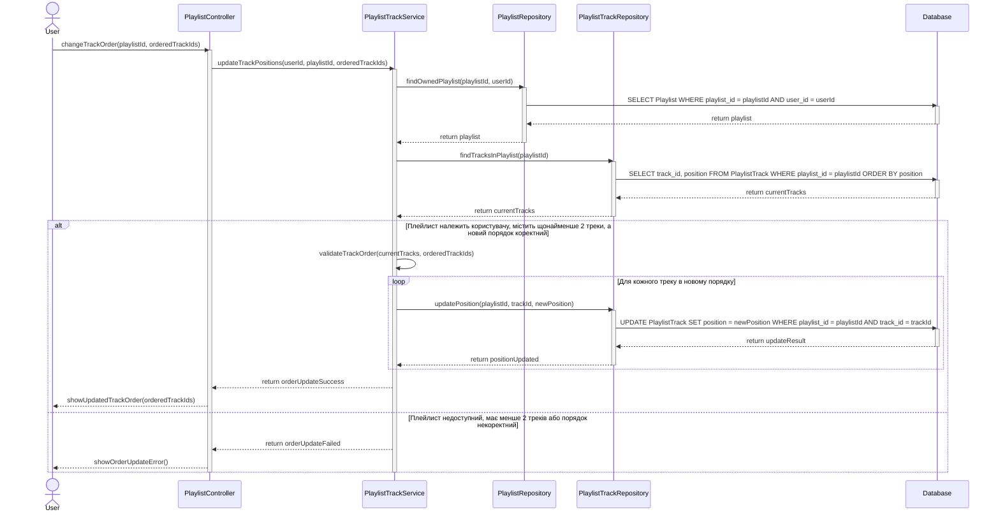

# Sequence-діаграми для Use Case: Playlists management

## 1. Прийняті архітектурні припущення

Діаграми побудовані на основі наданого Use Case та ER-моделі. ER-модель визначає сутності `User`, `Playlist`, `PlaylistTrack` і `Track`, але не задає конкретних сервісів, контролерів або репозиторіїв. Тому такі компоненти, як `PlaylistController`, `PlaylistService`, `PlaylistTrackService` та репозиторії, є архітектурними припущеннями для демонстрації взаємодії.

- `User` у діаграмах позначає автентифікованого користувача — актора.
- `Playlist` відповідає сутності плейлиста та полю `Playlist.user_id`.
- `PlaylistTrack` відповідає таблиці зв'язку між плейлистом і треком та містить `position`.
- `Track` відповідає сутності треку, який зберігається в системі незалежно від включення до плейлиста.
- Повідомлення з префіксом `return` позначають відповіді викликаних компонентів. У Mermaid вони подані пунктирними стрілками `-->`.
- Activation bars позначено через `activate` / `deactivate`. Для учасників, що працюють до й після комбінованого фрагмента, активація охоплює весь відповідний фрагмент.
- У кожній діаграмі є щонайменше один комбінований фрагмент `alt`, `opt` або `loop`.

> **Примітка щодо видалення плейлиста.** У сценарії Playlist deletion очікуваний результат сформульовано як видалення зв'язку між плейлистом і користувачем. Оскільки в ER-моделі цей зв'язок представлено полем `Playlist.user_id`, діаграма моделює від'єднання плейлиста від користувача (наприклад, встановлення `user_id` у `NULL`), а не фізичне видалення самого запису `Playlist`. Якщо за правилами застосунку видалення має означати повне видалення плейлиста, цю операцію потрібно змінити відповідно.

---

## 2. Scenario: Playlist creation

**Умова:** автентифікований користувач створює плейлист із непорожньою назвою. Система створює запис плейлиста та пов'язує його з обліковим записом користувача.



---

## 3. Scenario: Playlist deletion

**Умова:** користувач має створений плейлист і видаляє його. Відповідно до буквального формулювання сценарію система видаляє зв'язок між плейлистом і користувачем.



---

## 4. Scenario: Playlist track addition

**Умова:** користувач додає до свого плейлиста трек, який уже існує в системі. Система створює зв'язок `PlaylistTrack` і зберігає позицію треку.



---

## 5. Scenario: Playlist track removal

**Умова:** плейлист містить вибраний трек. Система видаляє лише зв'язок між плейлистом і треком. Сам запис `Track` залишається в системі.



---

## 6. Scenario: Change playlist tracks order

**Умова:** плейлист містить щонайменше два треки. Користувач змінює порядок, а система зберігає нові значення `PlaylistTrack.position`. Усі треки залишаються в плейлисті.



---

## 7. Scenario: Change other user's playlist state denial

**Умова:** автентифікований користувач намагається змінити плейлист іншого користувача. Система відмовляє в операції, а стан плейлиста не змінюється.

```mermaid
sequenceDiagram
    actor User
    participant PC as PlaylistController
    participant PS as PlaylistService
    participant PR as PlaylistRepository
    participant DB as Database

    User->>PC: changePlaylistState(playlistId, operation, payload)
    activate PC
    PC->>PS: authorizePlaylistChange(userId, playlistId, operation, payload)
    activate PS

    PS->>PR: findById(playlistId)
    activate PR
    PR->>DB: SELECT Playlist WHERE playlist_id = playlistId
    activate DB
    DB-->>PR: return playlist
    deactivate DB
    PR-->>PS: return playlist
    deactivate PR

    alt Плейлист належить іншому користувачу
        PS->>PS: verifyOwnership(userId, playlist.user_id)
        PS-->>PC: return accessDenied("Not playlist owner")
        PC-->>User: showAccessDenied()
        Note over PS,DB: Операція зміни не виконується; Playlist і PlaylistTrack залишаються незмінними
    else Плейлист належить поточному користувачу
        PS->>PS: validateRequestedOperation(operation, payload)
        PS-->>PC: return authorizedForChange
        PC-->>User: continueWithAuthorizedOperation()
    end

    deactivate PS
    deactivate PC
```

---

## 8. Перевірка відповідності вимогам

| Вимога | Реалізація |
|---|---|
| Окрема діаграма для кожного сценарію | Створено 6 діаграм |
| Синтаксис Mermaid `sequenceDiagram` | Використано в усіх діаграмах |
| Актори та учасники | Актор `User`, контролер, сервіси, репозиторії та база даних |
| Реалістичні назви операцій | Наприклад, `createPlaylist()`, `addTrack()`, `updatePosition()` |
| Повідомлення-відповіді | Пунктирні стрілки з результатами `return` |
| Activation bars | Використано `activate` і `deactivate` |
| Комбіновані фрагменти | У кожній діаграмі є `alt`; також використано `opt` і `loop` |
| Узгодженість з ER-моделлю | Операції спираються на `Playlist.user_id`, `PlaylistTrack.playlist_id`, `PlaylistTrack.track_id` і `PlaylistTrack.position` |
| Трек не видаляється з системи під час вилучення з плейлиста | Видаляється лише запис `PlaylistTrack` |
| Відмова у зміні чужого плейлиста | Перевіряється власник; за відмови мутація не виконується |

### Важливі зауваження

1. **Playlist deletion:** ER-модель не визначає, чи потрібно фізично видаляти плейлист, чи лише від'єднувати його від користувача. Поточна діаграма відповідає буквальному формулюванню «видаляє зв'язок між плейлистом і обліковим записом». Якщо `Playlist.user_id` є обов'язковим (`NOT NULL`) або бізнес-правило передбачає повне видалення, реалізацію треба скоригувати.
2. **Playlist creation:** перевірка непорожньої назви виконується до збереження. В гілці помилки операція завершується без створення запису.
3. **Playlist track addition:** `nextPosition` у прикладі означає позицію після останнього треку; у реальній реалізації треба визначити початкову позицію та поведінку для порожнього плейлиста.
4. **Change playlist tracks order:** оновлення позицій бажано виконувати в транзакції, щоб уникнути частково застосованого порядку, якщо один з `UPDATE` завершиться помилкою.
5. **Зміна чужого плейлиста:** сценарій показує відмову на перевірці власника до будь-яких змін. Для операцій додавання, видалення й перестановки треків така перевірка має виконуватися на сервері, а не лише в клієнтському інтерфейсі.
6. **Activation bars:** якщо Mermaid-рендерер суворо перевіряє вкладені активації, можна за потреби винести валідацію в окремий `PlaylistValidationService`; у такому разі `activate` / `deactivate` будуть однозначними для кожного учасника.
